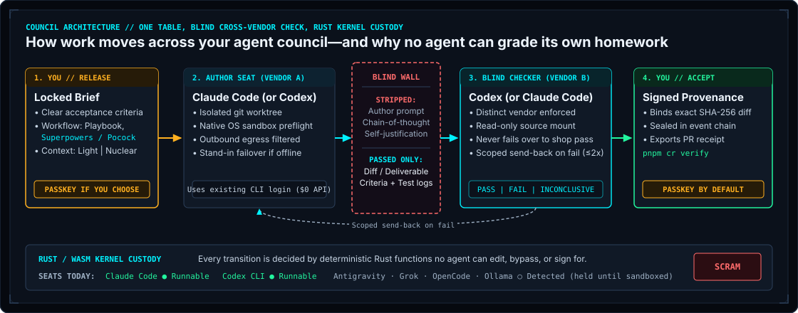
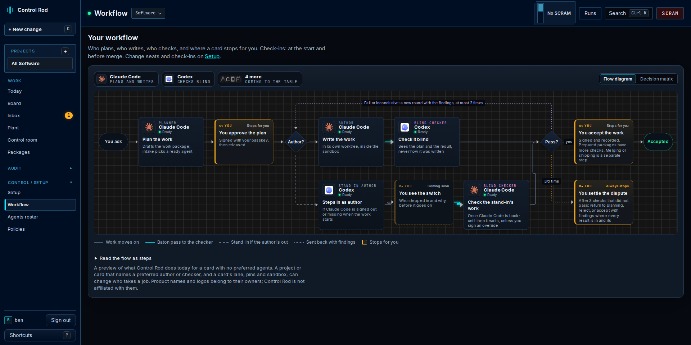
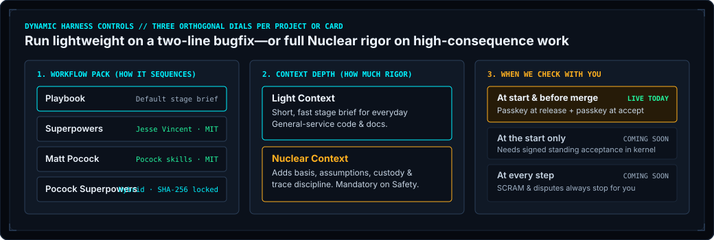
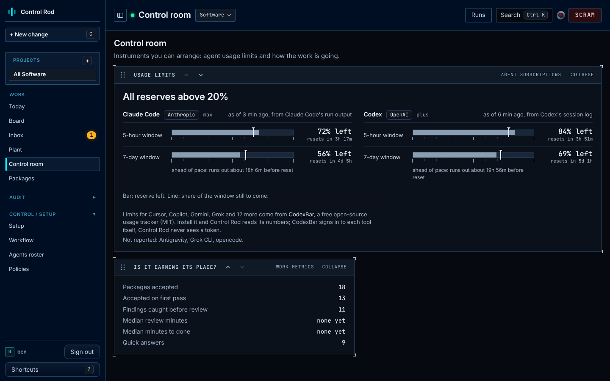
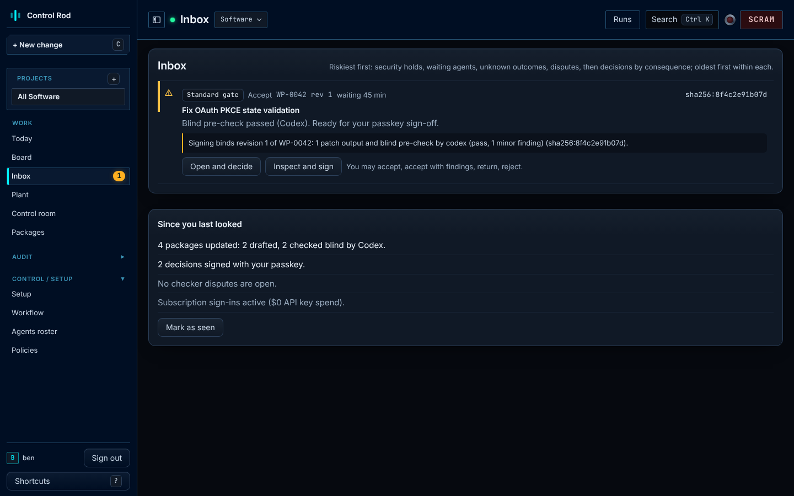
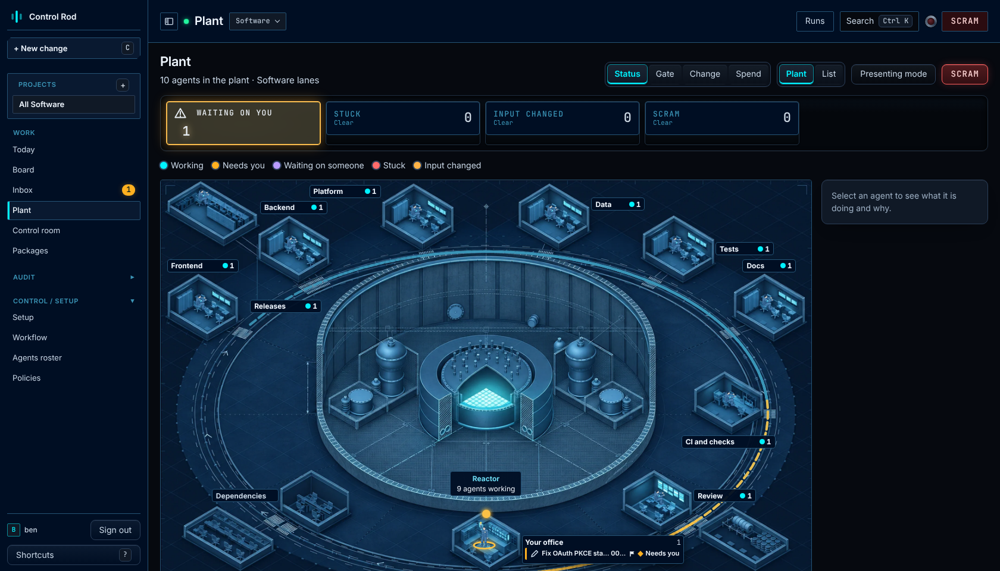

# Control Rod

**Seat every coding agent you pay for at one table. Never let one grade its own homework.**

[](https://github.com/FlyFission/Control-Rod/actions/workflows/ci.yml)
[](LICENSE)
[](docs/status.md)
[](docs/threat-model.md)

[Why Control Rod](#why-builders-use-control-rod) · [30s Standalone Check](#try-the-blind-checker-in-30-seconds) · [Empirical Evidence](#the-evidence-behind-it) · [Council & Workflows](#the-council--dynamic-workflows) · [Workspace Tour](#inside-the-control-room) · [Compare](#how-control-rod-compares) · [Install](#install-the-full-workspace)

**Control Rod** is a free, open-source multi-agent harness that runs on your own machine. Bring the command-line subscriptions you already pay for (**Claude Code** and **Codex** today, with zero API keys and zero cloud account), drop in what you want built, and let one agent work inside an isolated git worktree while a **different vendor's agent** checks only the diff and test evidence behind a blind wall. A deterministic **Rust/WASM kernel** decides every state transition, your passkey signs at release and at acceptance, and each accepted change exports a tamper-evident **PR receipt** anyone can verify offline.




> **Pre-alpha, built in the open.** Works end to end on one machine for one person. Public wording is linted by script for unqualified claims, and every research figure is read from recorded inputs. Read [what works today and what is stubbed](docs/status.md), or explore the [200-perspective front-door review](docs/research/outside-perspectives-2026-11/README.md) (a scripted rubric over modeled personas, not real user interviews).

---

## Why builders use Control Rod

- **One table for the subscriptions you already pay for ($0 API markup).** Control Rod drives the signed-in CLIs on your machine, never reads or stores login tokens, and shows live **5-hour and 7-day reserve gauges** in the Control Room so a rate-limit window never stalls a feature unannounced.
- **Blind cross-vendor verification on by default.** Every deliverable is checked by an agent from a different vendor family before it reaches your Inbox. Author prompts, chain-of-thought, and self-justification are stripped at the blind wall so the author cannot talk the checker into agreeing. If you only have one vendor installed, you can write a reason and sign an explicit override on the record.
- **Dynamic council routing & logged stand-in failover.** View your active council as a live block flow diagram or decision matrix (`/workflow`). When an author CLI is signed out or missing at dispatch, a seated stand-in can take the author role on the record (`Fallback: ran as …`), while checker seats never fail over to shop for a pass.
- **Per-card skill workflows (`Superpowers`, `Matt Pocock`, `Nuclear`).** Run a card on the plain Playbook, Jesse Vincent's **Superpowers**, **Matt Pocock's** skill stages, or their **Pocock Superpowers** hybrid—generated from pinned MIT commits and SHA-256 locked—paired independently with **Light** or **Nuclear** context depth.
- **You choose where you step in.** Today your passkey (Touch ID, Windows Hello, or a hardware security key) signs twice: when releasing work and when accepting a result. Next ([ADR 0024](docs/adr/0024-council-first.md), *planned*), choose check-in presets from *at the start* to *at every step*—while **SCRAM**, checker disputes, and tripped limits always stop for you.
- **A shareable PR receipt anyone can verify offline.** Export a provenance receipt (`pnpm cr receipt`) and check it against its sealed inclusion proof anywhere, without a server, via `pnpm cr verify`—or run the standalone blind checker on any git branch in 30 seconds.

---

## Try the blind checker in 30 seconds

Not ready to spin up the full board yet? Run Control Rod's cross-vendor blind checker standalone on **any git branch or GitHub pull request** with [`controlrod check`](docs/quickstart-check.md) or the reusable [`packages/check-action`](packages/check-action/README.md):

```sh
# 1. Build the standalone CLI once from the repo root (Go 1.24+; the checker CLI must be signed in)
go -C daemon build -o ~/.local/bin/controlrod ./cmd/controlrod

# 2. In any git repo: check this branch's diff with a checker from a different vendor family
controlrod check \
  --author-runtime claude \
  --checker codex \
  --base main --head HEAD \
  --criteria-text "1. Callback rejects missing or mismatched PKCE state.
2. No test assertions were weakened or skipped." \
  --output markdown
```


Full quickstart, exit codes (`0` pass, `1` fail/inconclusive, `2` refused), GitHub Actions YAML, and offline `pnpm cr verify --receipt` walkthrough: **[docs/quickstart-check.md](docs/quickstart-check.md)**.

---

## The evidence behind it

Control Rod's architecture—**one locked brief**, **a blind cross-vendor checker with real test evidence**, and **human passkey acceptance**—answers specific failure modes measured across published research:


1. **Why briefs are locked before an agent starts:** Giving the same instructions piece by piece across turns instead of in one complete brief cut performance by an average of **39%** across 15 LLMs and six tasks ([Laban et al., 2025](https://arxiv.org/abs/2505.06120)). Improving agent role specifications alone raised ChatDev's ProgramDev success rate by **+9.4 percentage points** on the same GPT-4o model ([Cemri et al., 2025](https://arxiv.org/abs/2503.13657)).
2. **Why self-checking without external feedback breaks down:** On graph coloring, GPT-4 solved **16%** alone, **2%** when checking itself, and **38%** with a sound external checker; on Game of 24, **5% -> 3% vs. 36%**; on Blocksworld planning self-checking rose **40% -> 55%**, with the outside checker at **60%** ([Stechly et al., 2024](https://arxiv.org/abs/2402.08115), Table 1). Intrinsic self-correction also dropped GPT-4 on GSM8K from **95.5% to 89.0%** and GPT-3.5 on CommonsenseQA from **75.8% to 38.1%** ([Huang et al., 2024](https://arxiv.org/abs/2310.01798); survey: [Kamoi et al., 2024](https://arxiv.org/abs/2406.01297)).
3. **Why the checker is blind and from another vendor:** GPT-4 distinguished its own generations **73.5%** of the time, and stronger self-recognition tracked stronger self-preference ([Panickssery et al., 2024](https://arxiv.org/abs/2404.13076)). Challenged on a right answer, Claude 1.3 wrongly admitted error **98%** of the time and suggestive pushback cut LLaMA 2 accuracy by up to **27%** ([Sharma et al., 2023](https://arxiv.org/abs/2310.13548)). AI judge scores correlate strongly with overlap in mistakes (average Pearson **r = 0.84**, [Goel et al., 2025](https://arxiv.org/abs/2502.04313)).
4. **Why a human still signs off:** Maintainers of `scikit-learn`, `Sphinx`, and `pytest` reviewed **296** AI-generated pull requests from SWE-bench Verified tasks; roughly **half** of the ones that passed the tests would not have been merged even after adjusting for maintainer noise ([METR, 2026](https://metr.org/notes/2026-03-10-many-swe-bench-passing-prs-would-not-be-merged-into-main/)).

> **Honesty on what is and isn't measured yet:** The outside checker in Stechly et al. (2024) is an exact program verifier, not a second LLM, and none of these papers measures one vendor's coding CLI reviewing another vendor's code. To measure that directly in the open at $0 API spend, Control Rod includes a frozen, repeatable SWE-bench evaluation harness: **[`pnpm cr bench`](bench/cross-check/README.md)**. Every figure above and the script that draws the SVGs live in [`docs/research/second-checker/`](docs/research/second-checker/).

---

## The council & dynamic workflows

Seat the CLIs on your machine once on **Setup**; Control Rod shows your exact routing as both a **Block Flow Diagram** and a **Decision Matrix**:



| Seat | Vendor family | Status on `main` today |
| --- | --- | --- |
| **Claude Code** | Anthropic | **Runnable** — plans, authors in git worktrees, and checks blind |
| **Codex CLI** | OpenAI | **Runnable** — plans, authors in git worktrees, and checks blind |
| **Antigravity, Grok CLI, OpenCode, Ollama** | Google, xAI, OpenCode, Local | **Detected & listed** — held switched off until each adapter is qualified to run inside its own sandbox |
| **Custom local or hosted endpoints** | User-named | **Planned** ([ADR 0024](docs/adr/0024-council-first.md)) |



---

## Inside the control room

### 1. Subscription reserve gauges & proof of value (`/control-room`)

Arrange movable console instruments showing your **5-hour and 7-day subscription windows** (read from CLI session logs and run streams—never by reading login tokens; optional [CodexBar](https://github.com/steipete/CodexBar) integration covers 12+ external tools) alongside **Is it earning its place?** (first-pass acceptances and findings caught before your review).



### 2. Inbox & passkey sign-off (`/inbox`)

Items sort **riskiest first**: security holds, lost leases, checker disputes, then gates by consequence. Signing binds the exact package revision, deliverable SHA-256 digest, and blind pre-check verdict (`Accept`, `Accept with findings`, `Return with direction`, or `Reject`).



### 3. The Plant & guarded SCRAM (`/plant`)

Watch 1 to 40 agents across an isometric nuclear facility built to ISA-101 high-performance display rules: calm and dark when healthy, warm amber only where something waits on you. Pulling the guarded **SCRAM** switch halts scoped runs, revokes active preparation grants in the same transaction, drops the reactor's control rods, and quarantines mid-flight outputs with digests until you review them. **Presenting mode** hides spend on shared screens.



### 4. Powerhouse second act: Capital Projects & high-consequence deliverables

Switch between **Software**, **Capital Projects**, and **Nuclear-Grade** modes on the same control spine:
- Draft, check, and sign **calculation packages, equipment datasheets, routing plans, and specifications** alongside code repositories.
- **Safety**, **Material**, and **General-service** grades enforce appropriate rigor (Safety and Material always run **Nuclear** context and require an independent qualified person beyond the originator).
- **Today** summarizes your shift brief above the fold; **Compare** lines up revisions side by side; **Snapshots** freezes repository checkpoints; and **Records** exports time-window audit bundles checkable offline with `pnpm cr verify`.

---

## How Control Rod compares

| Capability | Control Rod | Terminal Multiplexers | Single-Vendor IDE Agents | Cloud Agent Boards |
| --- | --- | --- | --- | --- |
| **Cross-vendor blind check** | **On by default** (strips reasoning) | Manual copy-paste | Same vendor & context | Optional human gate |
| **Uses existing CLI sign-ins** | **Yes** ($0 API key markup) | Yes | Single vendor | Often metered SaaS |
| **5h / 7d subscription gauges** | **Token-free Control Room meters** | Blind until rate-limited | Single vendor only | Dollar estimates |
| **State transitions** | **Deterministic Rust/WASM kernel** | Unstructured shells | Click-to-apply | Drag card to Done |
| **Human authority & emergency stop** | **WebAuthn passkey + scoped SCRAM** | `Ctrl+C` (unrecorded) | Local button | Cloud account click |
| **Offline-verifiable PR receipt** | **`pnpm cr receipt` + `pnpm cr verify`** | None | None | Locked in vendor DB |
| **Per-card skill workflows** | **Playbook, Superpowers, Matt Pocock** | Manual prompts | Editor rules | Custom templates |
| **Deliverables** | **Code patches + engineering packages** | Code only | Code only | Code / tickets |
| **License & telemetry** | **Apache-2.0 · zero phone-home** | Mixed (often AGPL) | Proprietary | Source-available / SaaS |

---

## Install the full workspace

Control Rod runs locally on your own account and sign-ins. Install [mise](https://mise.jdx.dev) (`mise install` fetches the pinned toolchain), or bring [Node 22.12+](https://nodejs.org), [pnpm](https://pnpm.io/installation), and [Go](https://go.dev/dl/) (plus [uv](https://docs.astral.sh/uv/getting-started/installation/) if running Python checks or the Python SDK). Sign in to [Claude Code](https://claude.com/claude-code), [Codex](https://github.com/openai/codex), or both, and use a non-root user account (embedded PostgreSQL refuses root).

```sh
git clone https://github.com/FlyFission/Control-Rod.git
cd Control-Rod
pnpm install
pnpm cr doctor   # checks your CLIs, sandbox prerequisites, and setup
pnpm cr start    # builds on first run, then opens http://localhost:7300
```

Choose **Set up this machine**, register a passkey, confirm your seated agents, and land on the Board. `Ctrl+C` stops everything cleanly; your data stays in `~/.controlrod`. To preview the standalone interactive landing page locally, run `node scripts/serve-site.mjs` (`http://localhost:7310`).

| Surface | Windows (WSL2) | Linux | macOS |
| --- | --- | --- | --- |
| **Web workspace (`pnpm cr start`)** | Verified live | Scripted CI | Expected to work; not yet verified live |
| **Native CLI sandbox confinement** | Verified with live logins | Scripted CI ([Ubuntu 24.04 AppArmor step](docs/daemon.md#linux-setup)) | Scripted CI (`sandbox-exec`) |

Stuck? See **[docs/getting-started.md](docs/getting-started.md)** for step-by-step troubleshooting.

---

## Custody under the hood—and what Control Rod is not

Every state change is decided by pure Rust functions in [`kernel/`](kernel/) compiled to WASM. Agents never hold authority to release their own brief, accept their own patch, weaken base-branch acceptance criteria, or clear a SCRAM. Author runs launch with a native OS sandbox preflight (no unsandboxed fallback) and outbound egress filtering on by default (`CONTROLROD_EGRESS_FILTER`). Known bypass vectors are tracked in [`tests/redteam/catalog.yaml`](tests/redteam/catalog.yaml), where each entry is built toward a failing-closed test (many still pending).

**What it is not:** Control Rod is **not** a quality assurance program, a certification, or a substitute for qualified engineering judgment, and the full web app is not yet air-gap ready. Nothing here claims compliance with any standard; if you work under 10 CFR 50 Appendix B, NQA-1, or ISO 9001, **[docs/qa-standards.md](docs/qa-standards.md)** maps how its controls line up with every gap marked plainly.

---

## Building it with us

- **Run & verify a change:** [docs/getting-started.md](docs/getting-started.md) and [CONTRIBUTING.md](CONTRIBUTING.md)
- **Day-to-day workflow:** [docs/collaboration.md](docs/collaboration.md) and the one-page agent rules in [AGENTS.md](AGENTS.md)
- **Architecture & security:** [docs/adr/](docs/adr/), [docs/threat-model.md](docs/threat-model.md), [docs/auditing.md](docs/auditing.md), and the [docs index](docs/README.md)

| Directory | Role |
| --- | --- |
| `apps/web/` | Console UI: Board, Workflow diagram, Control Room, Inbox, Plant, Snapshots, Compare, Records |
| `site/` | Standalone zero-dependency interactive landing page (`node scripts/serve-site.mjs`) |
| `services/api/` | Fastify control plane, checksum-locked Postgres migrations, passkey auth, sealed event chain, PR receipts |
| `kernel/` | Pure Rust state-decision kernel (compiled to WASM; CODEOWNERS protected) |
| `daemon/` | Go runner daemon, `controlrod check` standalone CLI, worktree & native sandbox confinement |
| `packages/check-action/` | Reusable composite GitHub Action for cross-vendor blind PR checks |
| `packs/` | Role baselines and digest-locked `Superpowers`, `Matt Pocock`, and `Nuclear-Grade` packs |
| `bench/cross-check/` | Repeatable $0-API-spend SWE-bench cross-vendor checking benchmark (`pnpm cr bench`) |
| `spec/` | Contract-first TypeSpec definitions generating OpenAPI and JSON Schemas |

## License

Apache License 2.0. See [LICENSE](LICENSE), [NOTICE](NOTICE), and [THIRD_PARTY_NOTICES.md](THIRD_PARTY_NOTICES.md).

Built by [FlyFission Consulting Group](https://flyfission.com).
