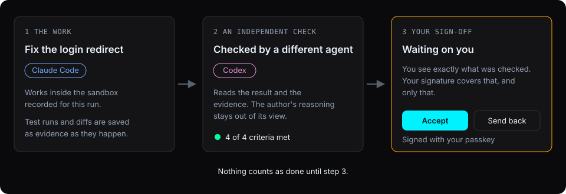
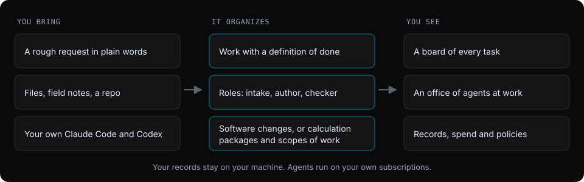

# Control Rod

**Agents can't mark their own homework.**

[](https://github.com/FlyFission/Control-Rod/actions/workflows/ci.yml)
[](LICENSE)
[](docs/status.md)

Control Rod is a workspace on your own machine where AI agents you already use (Claude Code, Codex) do real work, and the agent that did the work never gets the final say. A different agent checks the result without seeing how the author got there. Then *you* look at it and sign off. Until you do, nothing counts as finished, no matter how confident the agent sounds.



It runs in your browser. There's a board for your work, an office where you can watch agents at their desks, and a record of who did, checked and approved everything.

### Where it runs today

| | Windows (WSL2) | Linux | macOS |
| --- | --- | --- | --- |
| The app: board, office view, records, preparing and releasing work | Yes | Yes | Expected to work, not yet verified |
| Agents doing the work inside their sandbox | Yes | Waiting on sandbox qualification | Waiting on sandbox qualification |

> **Pre-alpha.** It works end to end on one machine for one person, and we're building it in the open. Expect rough edges. [What works today, and what doesn't](docs/status.md).

## A quick tour

### 1. The sign-off gate

The agent that did the work never gets the final say. A second agent checks it, and then you decide.

1. **Say what you want.** "Fix the login redirect." "Draft a scope of work from these field notes," with a file attached.
2. **Agree on what done means.** An intake agent drafts the work with clear acceptance criteria. You read it, edit it, and release it with your passkey.
3. **An agent does the work.** It runs inside the sandbox recorded for that run, and the system saves the test runs and changes as evidence while they happen.
4. **A different agent checks it.** The checker gets the result and the evidence. The author's reasoning stays out of its view.
5. **You decide.** Accept, send it back with notes, or reject. Your signature covers exactly what you looked at, and the history shows every step.

### 2. The office


Watch your agents at their desks while they work. Each figure's state comes from the real run, so you can see at a glance who is working, who is being checked and what is waiting on you.

1. **Open Office.** Agents sit in the room for their kind of work. When a room is full, the rest are listed beside it.
2. **Pick a world.** Choose one of fifteen worlds from the **Theme** menu, from a corner cafe to an orbital shipyard. A world changes the look and never the facts.
3. **Switch the lens.** **Status** shows what each agent is doing; **Gate** shows whether its work is before release, in work, in pre-check or awaiting your acceptance.
4. **Click a figure.** Its card shows the task, the checker's progress and the spend so far.
5. **Stop everything if you need to.** **SCRAM** tells you what it will stop, asks for a reason and your passkey, then stops those runs and records it.

**Presenting mode** hides spend, so you can put the office on a shared screen.

### 3. The whole workspace



The same discipline works for a code change or an engineering deliverable such as a calculation package or a scope of work.

1. **Bring your own agents.** Claude Code, Codex or both, on your own subscriptions.
2. **Let the roster do the routing.** Intake, author and checker roles keep the doing and the checking apart.
3. **Run it from the board.** Every task, its state and what it is waiting on, in one place.
4. **Look back any time.** Records, spend and policies show who did, checked and approved what.

## Why this exists

Most agent tools make it easy to start an agent and watch it go. That part is fun. The trouble comes at the end: the same agent that did the work also tells you it passed, and you either trust it or re-check everything yourself.

For a side project, fine. For work where a confident mistake is expensive (production code, engineering calculations, drawings) the final say needs to sit with a person.

Control Rod keeps the freedom and moves the final say. **You can work however you like, and the final say stays with you.**

| You can | An agent can't |
| --- | --- |
| Type anything, drop in files, and let an intake agent draft the work for you | Release a task, accept a result, or sign anything. Those need your passkey (Touch ID, Windows Hello or a hardware key). |
| Run Claude Code, Codex or both, on your own subscriptions | Check its own work. The checker runs separately and never sees the author's transcript. |
| Stop a run, send work back with notes, or override a rule *on the record*, with a reason | Edit its own acceptance criteria, policies or tests |
| Change what "done" means for a task, as long as you re-sign it | Type up a number and have it believed. Values have to come from a tool run that left evidence. |
| Set it up for software changes or for engineering deliverables like a calculation package or a scope of work | Get an answer without a reason. When the system refuses something, it says why. |

The deciding logic is a small Rust program (the *kernel*) that agents never touch. The system captures evidence while the work happens, so no agent writes its own report card. We keep a [catalog of every known way around a control](tests/redteam/catalog.yaml); each one is meant to become a test that keeps failing, and some are still pending.

## Try it

**Fastest:** open it in a ready-made environment with everything installed.

[](https://codespaces.new/FlyFission/Control-Rod)

Or, with Docker and VS Code, choose **Reopen in Container**. When it finishes setting up, run `pnpm cr start` in its terminal and the app opens in your browser. A Codespace is good for trying the app and for building it; see [the devcontainer notes](docs/getting-started.md#dev-container-and-codespaces) for what doesn't work there yet.

**On your own machine:** you need [Node 22+](https://nodejs.org), [pnpm](https://pnpm.io/installation), [Go](https://go.dev/dl/) and [uv](https://docs.astral.sh/uv/getting-started/installation/). To run real agents, install [Claude Code](https://claude.com/claude-code) and sign in. [Codex](https://github.com/openai/codex) is optional, and it's what lets checks run on their own: without it, each independent check waits for you to sign an override, because a second Claude model doesn't count as independent. Use an ordinary user account, since the bundled database won't run as root. [mise](https://mise.jdx.dev) can install everything above at the pinned versions: run `mise install`.

```sh
git clone https://github.com/FlyFission/Control-Rod.git
cd Control-Rod
pnpm install
pnpm cr doctor   # checks your setup and tells you what to fix
pnpm cr start    # builds on first run, then opens everything at http://localhost:7300
```

Open <http://localhost:7300>, choose **Set up this machine**, and register a passkey. That's the whole account: one machine, one person, no cloud sign-up. (Your agents still talk to their own providers, and the web app still loads some public fonts and map tiles, so it does not yet work fully offline.)

The first start builds the app and takes a few minutes. After that it's quick. `Ctrl+C` stops everything. Your data lives in `~/.controlrod`.

**If `pnpm cr doctor` says the database can't start:** it prints the fix. Usually a clean reinstall (`rm -rf node_modules && pnpm install`) does it. If not, point Control Rod at your own PostgreSQL 17 (Docker, Postgres.app or Homebrew all work) and everything else is the same.

More detail, test commands and troubleshooting: [docs/getting-started.md](docs/getting-started.md).

## What it is not

Control Rod isn't a quality assurance program, a certification, or a replacement for qualified engineering judgment. It produces discipline and records that a QA program can lean on; the people and processes around it still own quality and safety decisions. Nothing here claims compliance with a standard.

## Building it with us

We want this to be easy to join.

- **Start here:** [docs/getting-started.md](docs/getting-started.md) gets you running and shows how to check a change.
- **How we work:** [docs/collaboration.md](docs/collaboration.md) covers issues, branches, reviews and merging.
- **The rules, in one page:** [AGENTS.md](AGENTS.md). They apply to people and to the agents you drive.
- **Why it's built this way:** the [decision records](docs/adr/) and the [threat model](docs/threat-model.md).

The repo is built under its own discipline: each change gets a short record under `.nuclear/changes/`, contracts in `spec/` are the source of truth, and a few directories (`kernel/`, `policies/`, `spec/`, `tests/redteam/`, `.github/`) need a second pair of human eyes. [CONTRIBUTING.md](CONTRIBUTING.md) explains.

### Find your way around

| Where | What |
| --- | --- |
| `apps/web/` | The web app: inbox, board, office view, roster, records, spend, policies |
| `services/api/` | The API, database migrations, sign-in and the evidence record |
| `kernel/` | The Rust kernel that decides every state change |
| `daemon/` | The Go daemon that runs agents and collects evidence |
| `spec/` | The contracts everything else is generated from |
| `packs/` | Domain packs: the general-purpose agent roles and the software pack |
| `docs/` | Guides, decisions, specs and plans, starting at [docs/README.md](docs/README.md) |
| `policies/`, `connectors/`, `runtimes/`, `deploy/` | Placeholders for what's planned |

## License

Apache License 2.0. See [LICENSE](LICENSE) and [NOTICE](NOTICE).

Built by [FlyFission Consulting Group](https://flyfission.com).
