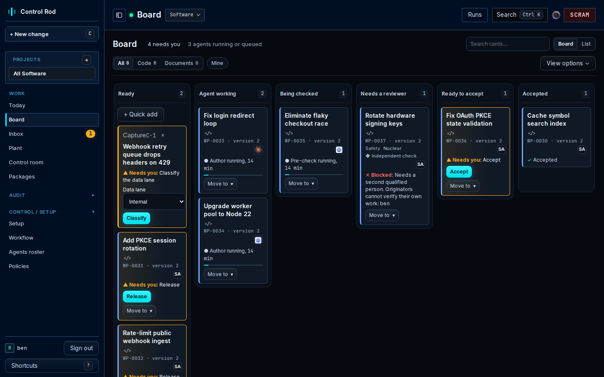
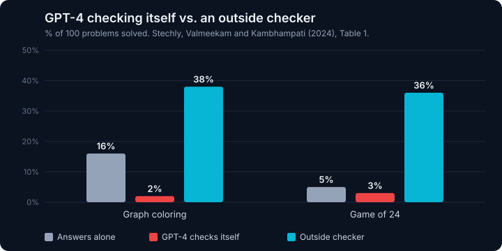
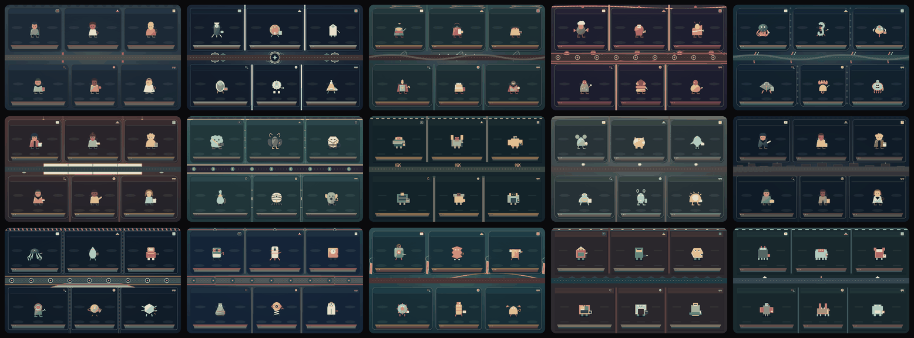

# Control Rod

**Put your coding agents at one table. A different one checks every result. You make the call.**

[](https://github.com/FlyFission/Control-Rod/actions/workflows/ci.yml)
[](LICENSE)
[](docs/status.md)

Control Rod is a free, open-source workspace that runs on your own machine. You drop in what you want done, an agent you already use picks it up, and a *different* agent checks the result without seeing how the first one got there. The work lands on a board, waiting for your yes. One window instead of a terminal per agent.



> **Pre-alpha.** It works end to end on one machine for one person, and it is built in the open. Expect rough edges. [What works today, and what doesn't](docs/status.md).

## Why Control Rod

- **A second opinion on by default.** Every result is checked by an agent from a different vendor before it reaches you. If you only have one vendor, you can give a reason and sign an override to let it check itself, and the record says so. The checker sees the work and the evidence, never the author's reasoning, so the author can't talk it into agreeing.
- **The agents you already have.** Control Rod drives the command-line agents you are signed in to, on the plans you already pay for. It never asks for an API key, and you don't need to buy anything new.
- **You make the call.** Agents do the work and the checking. Releasing work and accepting a result take your passkey (Touch ID, Windows Hello or a security key), so nothing counts as done until you say so.
- **You choose where you come in** *(planned)*. Today you step in twice: when work is released and when a result is accepted. Next, you pick your own stops, from one yes at the start to a look at every stage, and any check that falls back to something weaker is logged and flagged so you can step in before it merges.
- **One board for everything.** Every task, what it is waiting on and who has it, in one place, with a big red **SCRAM** button that stops runs on the record when you need everything to halt.

## Why a second model, not the same one

Published research keeps finding the same thing: a model is a poor judge of its own work.

**When GPT-4 checked its own graph-coloring answers, it solved 2% of them, down from 16% with no check at all. With a checker outside the model, it solved 38%.**



- **Checking itself can make a model worse.** Asked to review its own answers with no outside feedback, GPT-4 went from **95.5%** to **89.0%** on grade-school math, and GPT-3.5 went from **75.8%** to **38.1%** on common-sense questions ([Huang et al., 2024](https://arxiv.org/abs/2310.01798), Table 3).
- **Models recognize their own work and go easy on it.** GPT-4 picked out its own writing from other models' and people's **73.5%** of the time, and models that recognize themselves better also favor themselves more ([Panickssery et al., 2024](https://arxiv.org/abs/2404.13076)).
- **Look-alike models share blind spots.** AI judges gave higher scores to models more similar to themselves, measured by how often they make the same mistakes (average Pearson **r = 0.84**), and mistakes are getting more alike as models get more capable ([Goel et al., 2025](https://arxiv.org/abs/2502.04313)).

That is why Control Rod's checker comes from a different vendor and never sees the author's reasoning. To be clear about the evidence: the outside checker in the chart is a program that checks answers exactly, not a second AI model, and none of these studies measures one vendor's agent reviewing another's code. That is the bet Control Rod makes, and its records let you measure how it pays off on your own work. The figures, their conditions and the script that draws the chart are in [docs/research/second-checker](docs/research/second-checker/).

## The table

Bring the agents you use. Control Rod seats them as authors and checkers and keeps the doing and the checking apart.

| Agent | Today |
| --- | --- |
| Claude Code | Does work and checks work |
| Codex CLI | Does work and checks work |
| Antigravity, OpenCode, Grok CLI, Ollama | Detected and listed. Each one stays switched off until it can run inside its own sandbox. |
| Your own local or hosted models, by your names | Planned |

With two agents from different vendors (Claude Code and Codex today), checks run on their own. With one, each check waits for you, because the same model checking itself is not a second opinion.

## A quick tour

### The board

The board is home. Cards move left to right, from **Ready** to **Accepted**, and every card says plainly what it is waiting on. Type a card into **+ Add a card**, or press <kbd>C</kbd>. Filter by code or documents, group and color by person, switch to a compact view, and save the views you like. Open a card to read its agent's live transcript or stop its run.

Each card can run with **Light** context, which keeps the agent's brief short, or **Nuclear** context, which adds a deeper discipline for work that has to be right. Safety and Material grade work is always Nuclear.

### Sign-off


When the checker passes something, it shows up in your **Inbox** with the result, the evidence and the checker's findings. Accept it, send it back with notes, or reject it. Your signature covers exactly what you looked at, and the history keeps every step.

### The office



Watch your agents at their desks. Each figure's state comes from the real run, so you can see at a glance who is working, who is being checked and what is waiting on you. Pick one of fifteen worlds from the **Theme** menu, from The Coffee House Crew to Starport Shipyard; a world changes the look and never the facts. **Presenting mode** hides spend, so you can put it on a shared screen.

### And the rest

- **Today** gathers what needs you and what is running.
- **Compare** puts two candidate packages side by side before you decide, and **Explore** saves checkpoints of a repository you're working in.
- **Usage** shows whether agents are earning their place: acceptance, findings caught before review, and time to done.
- **Records** keep who did, checked and approved what, and `pnpm cr verify` checks an exported record offline.
- **Software** and **Capital Projects** modes run the same discipline on a code change or an engineering deliverable such as a calculation package.

## Try it

**Fastest:** open it in a ready-made environment with everything installed.

[](https://codespaces.new/FlyFission/Control-Rod)

When it finishes setting up, run `pnpm cr start` in its terminal and the app opens in your browser. With Docker and VS Code, **Reopen in Container** does the same. A Codespace is good for trying the app; [the devcontainer notes](docs/getting-started.md#dev-container-and-codespaces) say what doesn't work there yet.

**On your own machine** you need [Node 22+](https://nodejs.org), [pnpm](https://pnpm.io/installation), [Go](https://go.dev/dl/) and [uv](https://docs.astral.sh/uv/getting-started/installation/), or run `mise install` and [mise](https://mise.jdx.dev) fetches them all. Sign in to [Claude Code](https://claude.com/claude-code), [Codex](https://github.com/openai/codex) or both. Use an ordinary user account, since the bundled database won't run as root.

```sh
git clone https://github.com/FlyFission/Control-Rod.git
cd Control-Rod
pnpm install
pnpm cr doctor   # checks your setup and tells you what to fix
pnpm cr start    # builds on first run, then opens http://localhost:7300
```

Choose **Set up this machine** and register a passkey. That's the whole account: one machine, one person, no cloud sign-up. The first start takes a few minutes; after that it's quick. `Ctrl+C` stops everything, and your data lives in `~/.controlrod`.

| | Windows (WSL2) | Linux | macOS |
| --- | --- | --- | --- |
| The app | Yes | Yes | Expected to work, not yet verified |
| Agents working inside their sandbox | Yes | Yes ([Ubuntu 24.04 needs one step](docs/daemon.md#linux-setup)) | Yes |

Stuck? [docs/getting-started.md](docs/getting-started.md) covers troubleshooting, including what to do when the database won't start.

## How it works

A request becomes a card with clear acceptance criteria, which you release. An author agent does the work inside the sandbox recorded for that run, while Control Rod saves the test runs and changes as evidence. A checker from a different vendor gets the result and that evidence, and nothing else. Then the card waits for you.

Every state change is decided by a small Rust program (the *kernel*) that no agent can touch, so an agent can't release its own work, accept its own result, edit its own tests or type up a number and have it believed. When Control Rod refuses something, it says why. We keep a [catalog of known ways around a control](tests/redteam/catalog.yaml); each is meant to become a test that keeps failing, and some are still pending.

## What it is not

Control Rod is not a quality assurance program, a certification, or a replacement for qualified engineering judgment. It produces discipline and records that a QA program can lean on, and nothing here claims compliance with a standard. If you work under NQA-1, ISO 9001 or similar, [docs/qa-standards.md](docs/qa-standards.md) shows how its controls line up, with the gaps marked.

## Building it with us

- **Start here:** [docs/getting-started.md](docs/getting-started.md) gets you running and shows how to check a change.
- **How we work:** [docs/collaboration.md](docs/collaboration.md) covers issues, branches, reviews and merging.
- **The rules on one page:** [AGENTS.md](AGENTS.md). They apply to people and to the agents you drive.
- **Why it's built this way:** the [decision records](docs/adr/), the [threat model](docs/threat-model.md) and the [docs index](docs/README.md).

Each change gets a short record under `.nuclear/changes/`, contracts in `spec/` are the source of truth, and a few directories (`kernel/`, `policies/`, `spec/`, `tests/redteam/`, `.github/`) need a maintainer's sign-off. [CONTRIBUTING.md](CONTRIBUTING.md) explains.

| Where | What |
| --- | --- |
| `apps/web/` | The web app: board, inbox, office, records, usage and settings |
| `services/api/` | The API, database migrations, sign-in and the evidence record |
| `kernel/` | The Rust kernel that decides every state change |
| `daemon/` | The Go daemon that runs agents and collects evidence |
| `spec/` | The contracts everything else is generated from |
| `packs/` | Agent roles and playbooks: general, software and nuclear-grade |

## License

Apache License 2.0. See [LICENSE](LICENSE) and [NOTICE](NOTICE).

Built by [FlyFission Consulting Group](https://flyfission.com).
