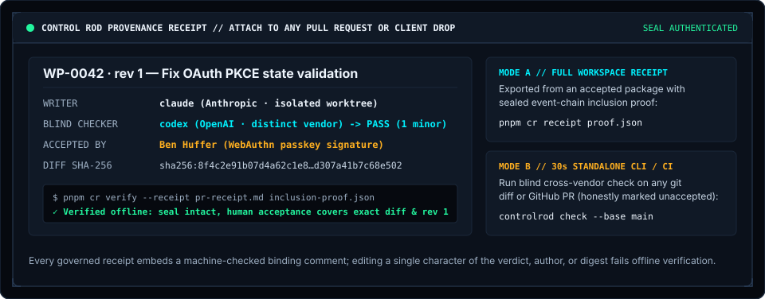

# Try the blind checker in 30 seconds (`controlrod check`)

You do not have to adopt the full board or set up a local database to see what Control Rod catches.

`controlrod check` runs Control Rod's **cross-vendor blind checker** directly on any git branch, pull request diff, or patch file against your acceptance criteria—using the CLI subscriptions you are already signed in to (`Claude Code` and `Codex`).



## Why start here?

- **Zero API keys, zero cloud account:** uses your existing `claude` and `codex` CLI logins.
- **Enforced vendor separation:** if `claude` (Anthropic) wrote the branch, `controlrod check` requires a distinct vendor family such as `codex` (OpenAI) to check it—and refuses same-vendor self-checking (`exit 2`).
- **Blind by construction:** the checker receives only the resolved `base..head` diff and the acceptance criteria, inside a read-only source mount with native CLI sandbox confinement (`bubblewrap` on Linux / WSL2, `sandbox-exec` on macOS). It never sees the author's prompt or chain-of-thought.
- **Protect the rubric:** pass `--criteria <file> --criteria-ref <trusted-base-ref>` to read the criteria from the base branch, so an author branch cannot weaken its own checklist. The GitHub Action does this by default for criteria files; the CLI does it only when you pass `--criteria-ref`.

---

## Option 1: Run locally on any git branch

Build the CLI once from the root of this repository (requires Go `1.24+`, or `mise install`). Only the checker's CLI (here `codex`) has to be installed and signed in; the author runtime is just declared:

```sh
go -C daemon build -o ~/.local/bin/controlrod ./cmd/controlrod
```

If `~/.local/bin` is not on your `PATH`, run it as `~/.local/bin/controlrod`.

Then, inside **any git repository** where an agent just wrote changes on a branch:

```sh
controlrod check \
  --author-runtime claude \
  --checker codex \
  --base main \
  --head HEAD \
  --criteria-text "1. Callback rejects missing or mismatched PKCE state before token exchange.
2. Expired state cookies return 401 and clear session state.
3. No test assertions were weakened or skipped." \
  --output markdown
```

### Exit codes (built for scripts and CI gates)

| Exit code | Meaning |
|---:|---|
| `0` | **Pass** — blind checker verified the diff against the criteria with no blocking findings |
| `1` | **Fail or inconclusive** — checker found a defect, missing evidence, or could not verify |
| `2` | **Refused** — invalid input, same-vendor checker (`claude` checking `claude`), or sandbox preflight refusal |

---

## Option 2: Drop into GitHub Actions (`packages/check-action`)

[`packages/check-action/action.yml`](../packages/check-action/action.yml) ships a reusable composite GitHub Action that computes `git merge-base`, reads the acceptance criteria from the **base commit** by default (so a PR cannot edit its own acceptance criteria), strips secrets from the agent environment, and writes a Markdown receipt to the job summary.

```yaml
jobs:
  blind-check:
    runs-on: ubuntu-latest
    timeout-minutes: 20
    steps:
      - uses: actions/checkout@3d3c42e5aac5ba805825da76410c181273ba90b1 # v7.0.1
        with:
          fetch-depth: 0
      - uses: FlyFission/Control-Rod/packages/check-action@<pinned-commit-sha>
        with:
          author-runtime: claude
          checker-runtime: codex
          criteria: docs/acceptance.md
          post-comment: "false"
```

The action builds or finds `controlrod`, but it does not install the checker CLI or sign it in: use a runner where the checker CLI (for example `codex`) is installed and authenticated, and where its native sandbox can run. See [`packages/check-action/README.md`](../packages/check-action/README.md) for the full security model and inputs.

---

## Option 3: Generate & verify a human-signed PR receipt offline

When you run work through the full Control Rod workspace (`pnpm cr start`), accepting a package with your passkey seals the author trace, the blind checker's verdict, and your WebAuthn signature into an append-only SHA-256 event chain.

Export the package's inclusion proof (`GET /packages/:id/proof` or from the **Records** page) and generate a tamper-evident Markdown PR receipt:

```sh
pnpm cr receipt inclusion-proof.json > pr-receipt.md
```

Anyone—a teammate, reviewer, client, or auditor—can verify that receipt **completely offline** without a Control Rod server, database, or account:

```sh
pnpm cr verify --receipt pr-receipt.md inclusion-proof.json
```

If a single character of the verdict, author, accepting person, revision, or `diff_sha256` in `pr-receipt.md` was edited after signing, `pnpm cr verify` fails closed.

What this proves: the receipt matches the sealed event bundle. The seal is checked against the public key carried in the bundle, so on its own it does not prove who owns that key or re-check each passkey assertion; the receipt says so with an **UNVERIFIED SEAL KEY** line (the offline CLI does not take a pinned trusted key yet).

> **Honesty note on standalone vs. governed receipts:** A standalone `controlrod check` run has no Control Rod control plane or passkey ceremony behind it, so its output marks `--author-runtime` as `(caller-declared, unverified)` and never claims verified human passkey acceptance. Full governed receipts come from `pnpm cr receipt <inclusion-proof.json>`.
