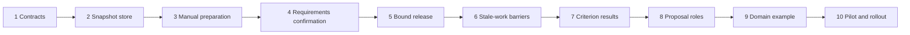

# Guided Preparation Implementation Plan

> **For agentic workers:** Use superpowers:executing-plans to implement this plan task-by-task after owner review. Steps use checkboxes for tracking. No execution method has been selected; this is a reviewable proposed sequence, not implementation authorization.

**Goal:** Extend the Control Rod MVP with resumable preparation, separately reviewed requirements and methods, criterion-level evidence, and revision-bound release.

**Architecture:** Immutable preparation companions extend WorkPackage without replacing its lifecycle. Fastify/Postgres own persistence and orchestration; the Rust kernel owns new confirmation/release eligibility. React extends the current workbench; the daemon carries scoped proposals using existing run custody.

**Tech Stack:** Existing TypeSpec, JSON Schema 2020-12, Fastify, Postgres, Rust/WASM, Go runner, React/TanStack Query, Vitest, Go tests, Cargo tests and WebAuthn. No new workflow framework or model SDK is required.

**Spec:** [Guided preparation design](../specs/2026-10-22-guided-preparation-design.md).

Status: proposed; no tasks executed. Date: 2026-10-22.

## Global constraints

- Integration target is PR #3 `26e3da117773731aaa3e24cb29c48cab26ba445b`, not merged main `40763d4`. Reconcile the current head, full Platform Plan and outstanding review before execution.
- TypeSpec is the contract source; raw records are validated before typed decode or digest; generated artifacts are regenerated, never edited.
- Engineering quantities remain decimal strings with units and recorded provenance.
- Preparation agents propose; humans confirm/release; the kernel decides. Preparation roles do not establish independent verification.
- Require `If-Match` with the current preparation content digest. Stale edits return 409; absent precondition returns 428.
- Companion feature version is `0.1.0`; existing 0.1 WorkPackage signed bytes remain unchanged.
- `guided_preparation` defaults off. Enrolled packages cannot fall back to legacy release.
- No new runtime powers before enforced role confinement and lane checks pass.
- Protected-surface changes require the human signature specified by AGENTS.md rule 2. Do not merge or imply that approval has been supplied.

## Review focus

| Failure mode | Expected behavior | Owning test |
|---|---|---|
| Two tabs edit the same draft | One succeeds, one receives a recoverable conflict | Task 2 `concurrent_edits_preserve_history` |
| An input changes during passkey release | Old assertion cannot release the new basis | Task 5 `source_update_racing_release_refuses` |
| A lost/stopped agent reports late | Retain attempt as history; no current draft mutation | Task 8 `late_proposal_cannot_change_head` |
| Same attachment filename with different bytes | Basis digest changes; readiness is invalidated | Task 6 `replacement_attachment_invalidates_basis` |
| Legacy route or old binary encounters an enrolled package | It refuses unsupported progression | Tasks 3/10 `legacy_edit_cannot_bypass_enrollment`, `downgrade_refused_for_enrolled_data` |

## Dependency map and delivery cuts

Cut A (tasks 1–3): durable manual draft, read/edit only; enrolled release disabled.
Cut B (tasks 4–7): complete manually prepared package lifecycle with freshness and evidence gates. This is the smallest releasable product slice.
Cut C (tasks 8–9): optional agent assistance and domain example; manual mode remains usable.
Cut D (task 10): reviewed rollout within the deployment scope actually supported.

## File and module responsibilities

Every new path below is proposed; paths read from the MVP are marked existing. Do not assume they exist on main.

| Path | Responsibility |
|---|---|
| `spec/preparation.tsp` (new) | Preparation, confirmation, manifest, result and view contracts |
| `spec/main.tsp`, `spec/api.tsp`, `spec/work.tsp` (existing) | Import records, declare API and role/runner extensions |
| `services/api/src/preparation/{store,readiness,service,basis,subjects,results}.ts` (new) | Immutable storage; pure consistency rules; commands; input freshness; digest subjects; result admission |
| `services/api/src/db/migrations/001-preparation.sql` and `migrate.ts` (new) | Versioned additive schema and capability gate; number reconciled against actual migration history |
| `services/api/src/preparation/routes.ts` (new) | Thin authenticated HTTP mapping |
| `services/api/src/{app,work,kernel}.ts` (existing) | Wire routes and enforce the feature at existing lifecycle seams |
| `kernel/src/preparation.rs` (new), `transition.rs`, `decision.rs`, `lib.rs` (existing) | Confirmation, readiness and stale-subject authorization |
| `apps/web/src/components/preparation/` (new) | Questions, requirements, plan, coverage and change review |
| `apps/web/src/pages/PackagePage.tsx`, `api/{client,types}.ts`, `components/DecisionBar.tsx` (existing) | Extend package experience and generated contract bindings |
| `packs/general/roles/{requirements-preparer,technical-preparer}.md` (new) | Original scoped role briefs |
| `daemon/internal/runner/{types,client,runtime,workspace}.go` (existing) | Validated wire messages and confined preparation jobs |
| `services/api/test/preparation*.test.ts`, web preparation tests, kernel tests, runner preparation tests (new) | Behavioral, authority, concurrency and context coverage |

Keep the feature cohesive in the preparation module; add narrow hooks to the large `work.ts` rather than an unrelated restructuring.

## Task 1: additive contracts and compatibility fixtures

Dependencies: reviewed design and reconciled MVP snapshot. Covers GP-01, GP-04, GP-05, GP-14.

**Files:** create `spec/preparation.tsp`, `spec/examples/preparation.bugfix.yaml`, `services/api/test/preparation-contracts.test.ts`, and the initial relationship-validation functions in `services/api/src/preparation/readiness.ts`; modify imports in `spec/main.tsp` and operations in `spec/api.tsp`; regenerate `spec/generated/`.

**Interfaces:** produces the records named in spec section 6, plus `PreparationEdit` (editable content only), `PreparationProposal`, `PreparationBlocker {code,item_id,owner,message}`, and `PreparationView`. `PreparationEdit` excludes identity, revision, actor, timestamps, digests, confirmation and readiness. Technical plan checks have `id`, `criterion_ids`, `method`, `required`, `expected_result`.

- [ ] Write failing fixture tests: `legacy_package_bytes_unchanged`, `unknown_preparation_fields_refused`, `bugfix_requires_repro_context`, `duplicate_ids_and_orphan_links_refused`, `criterion_order_matches_package`. Assert old fixture bytes/digest unchanged, malformed records rejected, retired IDs not reusable.
- [ ] Run `pnpm --filter @control-rod/api test -- test/preparation-contracts.test.ts`; confirm failures demonstrate the absent contracts/rules, not test setup mistakes.
- [ ] Add closed TypeSpec records. Put cross-record relationship checks in the pure readiness module, not JSON Schema claims it cannot enforce. Confirm conditional completeness in readiness, allowing incomplete drafts.
- [ ] Build with `pnpm --filter @control-rod/spec build`; rerun fixture tests and `pnpm -r typecheck`. Review generated JSON Schema/OpenAPI agreement.
- [ ] Stage only this task's files and commit after checks; use the real contributor's certification process, never forge a sign-off.

## Task 2: immutable snapshot store and migration capability

Dependencies: task 1. Covers GP-02, GP-11, GP-18.

**Files:** create `services/api/src/preparation/store.ts`, `services/api/src/db/migrate.ts`, `services/api/src/db/migrations/001-preparation.sql`, `services/api/test/preparation-store.test.ts`; modify DB startup wiring in `services/api/src/db/index.ts`.

**Interfaces:** `readPreparation(q: Db | Tx, packageId: string): Promise<PreparationView | null>`; `appendSnapshot(tx: Tx, packageId: string, expectedDigest: string, edit: PreparationEdit, actor: Actor): Promise<PreparationSnapshot>`; `enrollPreparation(tx: Tx, packageId: string, packageRevision: number, idempotencyKey: string, actor: Actor): Promise<PreparationSnapshot>`. Operations use one caller transaction, package-then-head lock ordering and server-assigned metadata. Readiness enrichment can be added in task 3.

- [ ] Add real-Postgres tests: `concurrent_edits_preserve_history` asserts exactly one update and one conflict from the same digest; `restart_retains_head_and_history`; `enrollment_retry_is_idempotent`; `snapshots_cannot_be_updated`; `migration_runs_once`.
- [ ] Run `pnpm --filter @control-rod/api test -- test/preparation-store.test.ts`; verify expected failure before implementing.
- [ ] Implement additive migration, schema-version table and durable capability metadata. Preserve legacy rows. Add append-only application permissions/triggers for load-bearing snapshots, confirmations/manifests and results. Reuse event append in the same transaction.
- [ ] Rerun task tests twice against the same migrated DB; assertions include rollback after an injected mid-transaction failure and no orphan head/event.
- [ ] Commit this independently reviewable storage change. No new release path is enabled.

## Task 3: manual preparation and resumable workbench

Dependencies: task 2. Covers GP-01–GP-05, GP-08, GP-16, GP-18.

**Files:** create `services/api/src/preparation/{service,routes}.ts`, `services/api/test/preparation.test.ts`, `apps/web/src/components/preparation/{PreparationPanel,QuestionList,RequirementsEditor,TechnicalPlanEditor}.tsx` and `preparation.test.tsx`; extend readiness from task 1; modify existing app wiring, package page, client, types and draft-edit seam.

**Interfaces:** `assessPreparation(snapshot: PreparationSnapshot, context: ReadinessContext): PreparationAssessment` is pure and does not authorize. Define `ReadinessContext { package: WorkPackage; confirmation: RequirementsConfirmation | null; currentBasis: BasisRef[]; retiredIds: string[] }` and `PreparationAssessment { requirementsConfirmed: boolean; readyForRelease: boolean; blockers: PreparationBlocker[] }`. `savePreparation(db: Db, cfg: WorkConfig, actor: Actor, packageId: string, expectedDigest: string, edit: PreparationEdit): Promise<PreparationView>`; `resolvePreparationItem(db: Db, cfg: WorkConfig, actor: Actor, packageId: string, expectedDigest: string, resolution: HumanResolutionInput): Promise<PreparationView>`. Client `preparation(id)`, `savePreparation(id, etag, edit)`, `resolvePreparationItem(id, etag, resolution)` return generated types and preserve ETag.

- [ ] Add failing API/web scenarios: AC-01–AC-05/AC-08/AC-16; `agent_cannot_confirm_question`; `legacy_edit_cannot_bypass_enrollment`; reload preserves answers; unresolved escalation blocks; keyboard operation exposes blocking owner and reason.
- [ ] Run the new API test and `pnpm --filter @control-rod/web test -- src/components/preparation/preparation.test.tsx`; establish red.
- [ ] Implement human-only edit/resolution endpoints, classify-specific fields, stable IDs, explicit human resolution and proposed-vs-confirmed UI. Preserve original capture and attachments. No automatic merge on 409; show changes and offer reload/reapply explicitly.
- [ ] Wire `finishIntake` to create the linked companion for new packages when enabled, retaining all multi-package capture links. Update editable package fields and snapshot `package_contract` atomically. Wire existing draft edits to companion-aware changes or refuse them; ensure client cannot downgrade rigor, data lane or enrollment through a parallel endpoint. Disable release for enrolled packages until task 5 is complete.
- [ ] Run API/web scenarios plus existing `app.test.ts` and component suites; build both workspaces, then commit.

## Task 4: signed requirements confirmation

Dependencies: task 3; exact kernel trust-surface signature before editing protected functions. Covers GP-03, GP-06, GP-11.

**Files:** create `services/api/src/preparation/subjects.ts`, `kernel/src/preparation.rs`, `services/api/test/preparation-confirm.test.ts`; modify `kernel/src/{transition,decision,lib}.rs`, API kernel bridge, auth challenge wiring and preparation routes; add workbench confirmation control.

**Interfaces:** `requirementsSubject(snapshot: PreparationSnapshot, pkg: WorkPackage): RequirementsSubject`; `confirmRequirements(db: Db, cfg: WorkConfig, actor: Actor, packageId: string, verified: VerifiedPreparationAssertion): Promise<RequirementsConfirmation>`. `VerifiedPreparationAssertion` is server-internal and never accepted from public JSON. Kernel `decide_preparation(req: &PreparationRequest) -> PreparationOutcome` consumes server-built current/expected digests, action, actor, verified signature and blockers; no I/O. Action `confirm-requirements` is human-only.

- [ ] Write refusal tests: wrong actor, wrong package/action, tampered statement, changed input/rigor/lane, replay, expiry, missing signature, open requirements blocker. Assert valid confirmation queues zero author runs.
- [ ] Run `cargo test --locked -p controlrod-kernel` at repository root and `pnpm --filter @control-rod/api test -- test/preparation-confirm.test.ts` to establish red.
- [ ] Add canonical subject construction, existing passkey options/verify integration, single-use challenge consumption, kernel authorization and confirmation insert atomically. Pin all confirmation fields from spec section 6.
- [ ] Test a technical-plan-only edit preserves requirements confirmation, while a requirements/basis edit invalidates it. Run kernel/API/browser-component checks; rebuild WASM via the existing MVP build command, never edit generated bindings.
- [ ] Commit code plus updated trace/verification; record the actual protected-surface signature separately from test evidence.

## Task 5: complete release subject and enforced enrollment

Dependencies: task 4. Covers GP-07, GP-09, GP-12, GP-14.

**Files:** extend `subjects.ts`, `readiness.ts`, `services/api/src/work.ts` (`subjectOf`, `decisionSubject`, `applyDecision`, `claim`), kernel preparation/transition modules, `DecisionBar.tsx`; create `services/api/test/preparation-release.test.ts`.

**Interfaces:** `buildReleaseManifest(tx: Tx, pkg: PackageRow, snapshot: PreparationSnapshot): Promise<PreparationReleaseManifest>`; `assertPreparationCurrent(tx: Tx, packageId: string, packageRevision: number): Promise<PreparationReleaseManifest | null>` returns null only for server-classified legacy packages. Kernel requests gain explicit enrolled/current/readiness facts, defaulting absent facts to refusal when enrollment is required.

- [ ] Add tests for AC-07/AC-09/AC-14 and `source_update_racing_release_refuses`, same subject requested twice, changed criterion string, omitted manifest, changed method, direct legacy release request and client-supplied readiness. Assert valid release produces one decision, manifest and author run.
- [ ] Establish red with `pnpm --filter @control-rod/api test -- test/preparation-release.test.ts` and kernel tests.
- [ ] Extend the existing signed subject with the manifest; check every readiness obligation through the kernel decision path. Store release manifest and author queue in the same transaction. Store a content-only package digest so lifecycle status changes do not invalidate it.
- [ ] Test failure injection after decision creation rolls back the manifest/run/event; test two simultaneous valid assertions cannot queue two authors. Browser release review displays basis/check coverage and detects a stale subject.
- [ ] Run full existing API/kernel lifecycle regressions; commit. Keep feature default off until tasks 6–7 pass.

## Task 6: basis invalidation and in-flight barriers

Dependencies: task 5. Covers GP-07, GP-10, GP-11, GP-18.

**Files:** create `services/api/src/preparation/basis.ts`, `services/api/test/preparation-freshness.test.ts`; modify existing input-update/import paths, `work.ts` claim/completion/decision seams, preparation readiness and web change review.

**Interfaces:** `refreshPreparationBasis(tx: Tx, packageId: string, observed: BasisRef[], actor: Actor): Promise<PreparationView>`; `holdDependents(tx: Tx, changed: BasisRef, cause: string): Promise<string[]>`. Existing claim, complete and applyDecision call `assertPreparationCurrent` while holding the same package lock; no unchecked cached readiness.

- [ ] Add `replacement_attachment_invalidates_basis`, branch target change, changed source revision, source change racing claim/completion/acceptance, completion after stop, false stale signal from lifecycle-status-only change, and accepted-history preservation.
- [ ] Establish red with `pnpm --filter @control-rod/api test -- test/preparation-freshness.test.ts`.
- [ ] Implement exact version/digest comparison, transactional holds, stop requests and stale-output quarantine. Retain attempted completion plus refusal evidence; never apply it to the current revision. Record last externally observed basis time.
- [ ] Verify requirement/criterion edits receive no deadband exemption; unknown external freshness is displayed honestly. Test returning a package creates a new revision whose preparation requires re-review and cannot reuse an old manifest.
- [ ] Run concurrency and existing custody/requeue tests; commit.

## Task 7: criterion results and acceptance coverage

Dependencies: task 6. Covers GP-05, GP-12, GP-13.

**Files:** create `services/api/src/preparation/results.ts`, `services/api/test/preparation-results.test.ts`, `apps/web/src/components/preparation/CriterionCoverage.tsx`; modify runner completion contract in TypeSpec, work.ts pre-check completion and accept subject, kernel eligibility and workbench results view.

**Interfaces:** `admitCriterionResults(tx: Tx, manifest: PreparationReleaseManifest, verification: VerificationRecord, results: CriterionResultSet): Promise<void>`; `criterionCoverage(manifest: PreparationReleaseManifest, results: CriterionResultSet | null): CriterionCoverage[]`. Result association follows criterion IDs, never string matching. The server checks the referenced verification digest and retained evidence artifacts.

- [ ] Add tests for omitted/duplicate/unknown criteria, wrong verification or manifest digest, missing artifact, unexecuted mapped check and multiple required checks. Assert any required failure prevents normal acceptance.
- [ ] Establish red with `pnpm --filter @control-rod/api test -- test/preparation-results.test.ts` and kernel acceptance tests.
- [ ] Implement result companion admission and coverage projection. Preserve original failed/open outcomes under `accept-with-findings`; bind exception reason and result set into the signed subject. Stale basis and missing mandatory verification remain non-waivable.
- [ ] Build checker inputs with explicit allowlist; assert canary strings from private preparation and author transcripts never appear. Include released methodology with shared-mechanism disclosure, not an independence claim.
- [ ] Run existing checker override/independence and decision regressions plus web coverage tests; commit. Cut B is reviewable for a manual pilot, subject to task 10 release checks.

## Task 8: scoped preparation proposal jobs

Dependencies: task 7 and demonstrated runtime confinement. Covers GP-02, GP-03, GP-07, GP-08, GP-13, GP-15, GP-18.

**Files:** extend `spec/work.tsp` RunRole and generated runner contracts; create `packs/general/roles/{requirements-preparer,technical-preparer}.md`, `services/api/test/preparation-proposals.test.ts`, `daemon/internal/runner/preparation_test.go`; modify runner client/types/runtime/workspace and preparation service/job links.

**Interfaces:** `requestPreparationProposal(db: Db, cfg: WorkConfig, actor: Actor, packageId: string, expectedDigest: string, role: PreparationRole): Promise<Run>`; `applyPreparationProposal(tx: Tx, run: Run, proposal: PreparationProposal): Promise<PreparationView>`. `PreparationRole` is the two named authoring roles. Proposals carry base snapshot digest and editable fields only. Existing runner claim token/outbox/completion receipt semantics remain in force.

- [ ] Add `late_proposal_cannot_change_head`, duplicate completion, wrong assignment/base digest, agent-crafted human confirmation, role escalation, prompt injection in attachment, lane-incompatible runtime and fake unknown wire field tests.
- [ ] Establish red in API and Go runner suites. Use generated contracts to validate raw claim/completion messages before decoding; include duplicate-key and absent-required-field refusal.
- [ ] Implement original briefs and role-specific bundles. Host creates a read-only repository snapshot with commit/blob manifest; no inherited credentials, hooks or write-capable shell access. Runtime without a tested confinement capability is not offered for technical preparation.
- [ ] Run a genuine write/egress/secret-access refusal probe for every offered runtime profile. The existing Claude print runtime is unavailable for this role until an enforced driver exists; no prompt-only exception.
- [ ] Verify restart/retry/outbox and role context tests, then commit. Record fake-vs-live runtime evidence separately; failure of live runtime leaves the manual product slice usable.

## Task 9: software and engineering walkthroughs

Dependencies: task 8 for agent walkthrough; manual domain support can be prepared after task 7. Covers GP-04, GP-07, GP-08, GP-17.

**Files:** add `spec/examples/preparation.hvac-load-calc.yaml`, companion bugfix result fixtures and `docs/guides/preparing-work.md`; extend contract/API fixture tests and workbench user tests.

**Interfaces:** examples consume exactly the released companion contracts. No domain-specific API or custom approval path is introduced.

- [ ] Add a regression journey: capture bug repro → confirm → technical plan → release → failing/passing criterion result → decision. Add HVAC with missing design input, provisional assumption, rerun and alternate calculation checks.
- [ ] Run fixture validation and demonstrate the missing-input package cannot release. Keep illustrative engineering quantities sourced from existing controlled examples or tool outputs; do not fabricate a calculation result.
- [ ] Write a concise guide showing who decides, how to resume, how to resolve infeasibility, and how a changed input affects work already running. Include an explicit legacy/prepared distinction.
- [ ] Run one browser walkthrough with software passkey and deterministic runtime, then a real supported runtime as a separate pilot if available. Preserve trace/runtime capability and observed limits.
- [ ] Commit fixtures, tests and guide; no claim of calculation qualification or regulatory adequacy.

## Task 10: rollout, regression and operational handoff

Dependencies: tasks 1–7 for manual release; tasks 8–9 for agent-assisted release. Covers all requirements and remaining GP-14–GP-16 obligations.

**Files:** update feature settings/startup capability check, `docs/guides/preparing-work.md`, this packet's verification/ship records, and proposed test catalog/CI changes only with required signatures.

**Interfaces:** startup checks `guided_preparation` schema capability against binary capability; old binaries refuse enrolled data. Events: `preparation.created`, `preparation.updated`, `preparation.confirmed`, `preparation.stale`, `preparation.escalated`, `preparation.proposal-refused`, `preparation.released`; payloads carry IDs/digests, not private transcript text.

- [ ] Add `downgrade_refused_for_enrolled_data`, feature disabled after enrollment, unauthenticated/cross-origin mutation and restore-from-backup scenarios. Test that disabled automation does not prevent manual draft editing/history reads.
- [ ] Run focused tests first; then `pnpm --filter @control-rod/spec build`, generated drift review, `pnpm -r typecheck`, `pnpm -r test`, `cargo fmt --check`, `cargo clippy --all-targets -- -D warnings`, `cargo test --locked`; run `go vet ./...` and `go test ./...` in daemon. Run existing license gates and Python domain tests if affected. Read the actual MVP scripts before issuing WASM/browser commands; do not invent script names.
- [ ] Add AC-01 through AC-18 results to the trace with artifact paths, custody and actual commands. Re-run signed-subject test vectors across consumers. Contract generation may legitimately change in this branch; regeneration must produce no further diff after expected output is committed.
- [ ] Rehearse backup/restore and feature-off rollback. Define dashboards/counts for unresolved blockers, stale refusals, proposal failures and release conflicts. Record runtime failures without capture/attachment contents in metrics.
- [ ] Obtain review of actual kernel/policy/CI changes, owner pilot feedback, residual risks and go/no-go decision. Keep default off if a gate is unresolved; release manual and agent capabilities separately.

## Requirement-to-task coverage

| Requirement | Tasks | Decisive planned seam |
|---|---|---|
| GP-01 | 1, 3 | API enrollment/capture linkage |
| GP-02 | 2, 3, 8 | DB restart plus resumed UI |
| GP-03 | 3, 4, 8 | Human/agent authorization refusals |
| GP-04 | 1, 3, 9 | Context-specific readiness fixtures |
| GP-05 | 1, 3, 7 | Stable IDs and result admission |
| GP-06 | 4 | Kernel + verified WebAuthn API |
| GP-07 | 5, 6, 8, 9 | Manifest/source checks |
| GP-08 | 3, 8, 9 | Escalation cannot silently alter criterion |
| GP-09 | 5 | Transactional release subject |
| GP-10 | 6 | Concurrent input change barriers |
| GP-11 | 2, 4, 6 | CAS/history and confirmation invalidation |
| GP-12 | 5, 7 | Coverage vs observed result and acceptance |
| GP-13 | 7, 8 | Checker context canaries/custody |
| GP-14 | 1, 5, 10 | Legacy byte preservation and downgrade refusal |
| GP-15 | 8, 10 | Runtime confinement/lane refusal |
| GP-16 | 3, 5, 10 | Accessible review + stale browser refusal |
| GP-17 | 9 | Engineering fixture with input hold |
| GP-18 | 2, 3, 6, 8 | Idempotency and stale completion |

## Execution entry and completion

Before execution: review this spec and plan; choose the execution baseline; reconcile the full Platform Plan and current PR findings; create an isolated branch/worktree using the repository workflow; record the exact approved trust-surface scope. No implementation agent should infer approval from this draft's existence.

At each task: read interfaces and dependencies, write the behavioral failure, demonstrate it, implement narrowly, verify, update evidence and commit only the task's changes. Exact future line numbers are intentionally omitted because the integration source is an open branch; function seams and pinned snapshots above identify the targets.

Completion means the delivered feature satisfies the mapped scenarios at the actual release commit, with migration and runtime limitations disclosed. A checked plan is not a passing implementation. Estimates should follow the baseline reconciliation and confinement spike; no unsupported calendar promises are made here.
