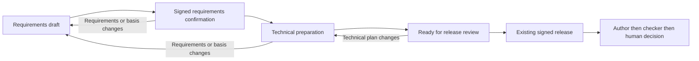

# Guided work-package preparation: product and technical specification

Date: 2026-10-22. Status: **proposed, ready for owner review**. Implementation and release approval: **not recorded**.

## 1. Purpose and scope

Help a requester turn a rough request into a work package that an engineer can review, an agent can execute, and a checker can evaluate against the same requirements. Preserve the distinction between desired results, proposed methods, observed evidence and authorized decisions.

The user endorsed six directions: guided intake, separate requirements and technical preparation, stable criterion IDs, revision-bound preparation, explicit escalation and resumable drafts. This document proposes how to implement them. It covers a single preparation subsystem integrated with the existing MVP. It does not authorize coding, publication, protected-surface changes or release.

Primary actors: requester, technical reviewer, preparation agent, author, checker and decision owner. The MVP owner may occupy the human roles; record capacities separately without claiming organizational separation. Requirements confirmation is not package release, and a technical preparer is an authoring participant, not an independent checker.

Success means a user can prepare and resume a software bug-fix package, inspect what remains unresolved, review a grounded technical plan, release the exact reviewed subject, and see evidence coverage by criterion. The same model must represent an engineering calculation without pretending every check is a software test.

## 2. Verified baseline and integration target

| Snapshot | Observed capability | Consequence for this plan |
|---|---|---|
| Main `40763d4153eabd542d0c7ef028b8aab5de8d6522` | Closed TypeSpec contracts, canonical digests, in-memory API, fail-closed kernel skeleton | Insufficient foundation for a durable preparation workflow |
| Open PR #3 `26e3da117773731aaa3e24cb29c48cab26ba445b` | Capture intake, Postgres records, draft editing, passkey decisions, runner custody, author and pre-check roles, React workbench | Intended integration target after review and reconciliation |
| Open PR #4 `ba32feeb4e786d88b8aa23460689b3b72974133c` | Workbench/pattern documentation | Context only; do not fork a second workbench |

Source references in section 15 are pinned. Existing source inspected on PR #3:

- `services/api/src/work.ts`: createCapture, finishIntake, updateDraft, subjectOf, decisionSubject, applyDecision, claim, complete. Intake currently emits an answer or package drafts; draft updates preserve assignment and verification; return creates a new package revision.
- `services/api/src/db/schema.ts`: packages, captures, runs, outputs, verifications, decisions, append-only events, run leases and unique live-run index.
- `kernel/src/transition.rs`: human-only signed lifecycle actions and checker/runtime rules. Release currently checks actor/signature/state, not preparation readiness.
- `apps/web/src/pages/PackagePage.tsx`, `components/DecisionBar.tsx`, `api/client.ts`: package editing, review and decision integration points.
- `spec/records.tsp`, `work.tsp`, `api.tsp`: contract sources. Acceptance criteria are strings; evidence has a textual claim.
- `daemon/internal/runner/types.go`: run claim, inputs, completion and trace boundary.

This review did not execute the MVP or independently confirm PR test claims. The full Platform Plan is not present in the inspected source. The output of prior local reviews is advisory context; unresolved review findings must be reconciled against the chosen execution baseline.

## 3. Alternatives and chosen approach

| Approach | Benefit | Cost / limitation | Decision |
|---|---|---|---|
| Stronger intake prompt only | Quick improvement using the current runner | Cannot enforce revision binding, durable questions or criterion coverage | Use only as an interim aid |
| Versioned preparation companion linked to WorkPackage | Reuses the package lifecycle and supports incremental migration | Adds contracts and a bounded review workflow | **Recommended** |
| Replace WorkPackage with product-spec and technical-spec lifecycles | Strict separation throughout the platform | Breaks existing consumers and duplicates approval machinery | Defer |

Keep `WorkPackage` as the executable contract. Add typed preparation records and an immutable release manifest. Do not replace the existing criterion strings in place. Markdown views are generated from records, not independently editable sources of truth.

## 4. User journeys

### Software enhancement or bug fix

1. A person captures a request using the current workbench. An answer-only request stays outside the preparation workflow; consequential work cannot be silently downgraded to an answer to avoid required review.
2. Intake proposes a package and preparation draft. Classify enhancement, bugfix, engineering deliverable or general work. Classification is editable; no model-generated classification grants permission.
3. The preparation view shows the original capture, confirmed facts, proposals and open questions. Ask one focused question or a tight group; allow answering, editing the draft, deferring with reason, or resuming later.
4. For a bug, preserve repro steps, expected/actual behavior and environment. For an enhancement, preserve current and desired journeys. Draft atomic requirements and criteria; implementation suggestions remain non-binding notes.
5. The human reviews and confirms a requirements snapshot with a passkey. This authorizes technical preparation only, not an author run.
6. A technical reviewer prepares the approach, affected components, alternatives, tasks and verification checks. In the first slice this is manual. Later an agent may propose it from a controlled repository snapshot.
7. The workbench shows the complete release subject, exact input basis, coverage and blockers. The existing signed release action approves the technical plan and starts execution; there is no additional mandatory technical-approval ceremony in the MVP.
8. The author and checker receive role-specific inputs. Criterion coverage appears alongside actual outcomes. A changed basis forces review before progression.

### Capital Projects

Use engineering intent, design basis, design-input revisions, assumptions, methodology, deliverable maturity and verification method. For an HVAC calculation, checks may include rerun reproducibility and alternate calculation. Missing controlled inputs remain holds; approved provisional assumptions must name owner, basis and permitted use. Engineering quantities remain strings with units and recorded provenance. No model invents engineering values.

## 5. Requirements and acceptance scenarios

All rows are normative proposed requirements. Every scenario is planned, not executed evidence.

| ID | Requirement | Acceptance scenario |
|---|---|---|
| GP-01 | Reuse Capture and WorkPackage; preparation is a companion | AC-01: one capture produces one linked preparation per selected package; retry creates no duplicate; multi-package captures retain all links |
| GP-02 | Save questions, answers, ownership and review state durably | AC-02: after reconnect/restart, the same draft, answered questions and unresolved items load without re-interview |
| GP-03 | Distinguish human-confirmed facts, proposals and unconfirmed assumptions | AC-03: agent output cannot mark an item confirmed or clear a human-owned blocker; the original request remains visible |
| GP-04 | Separate desired outcome from technical approach | AC-04: bugfix requires repro/expected/actual/environment; enhancement requires current/desired journey; method suggestions stay non-binding |
| GP-05 | Assign stable requirement/criterion IDs and explicit mappings | AC-05: reordering preserves IDs; deleted IDs are retired, never reused; orphan or duplicate links block readiness |
| GP-06 | Confirm requirements through a signed human action | AC-06: daemon/agent, replay, wrong action, expired challenge and changed snapshot cannot confirm; confirmation never queues an author |
| GP-07 | Ground technical preparation in the inspected basis | AC-07: plan references repository commit/path/blob digest or document revision/digest; missing referenced material blocks technical readiness |
| GP-08 | Escalate infeasible or conflicting requirements without weakening them | AC-08: an escalation records criterion, reason, alternatives and owner; only a human resolution changes the requirement or acknowledges a permitted assumption |
| GP-09 | Bind release to package, preparation, confirmation and input manifest | AC-09: editing any subject member after challenge issuance refuses release; a valid release queues exactly one author |
| GP-10 | Invalidate readiness when its controlled basis changes | AC-10: source revision or digest mismatch marks preparation stale, blocks release/claim/submission/normal acceptance and identifies the cause |
| GP-11 | Keep versions immutable and reject stale writes | AC-11: two edits from the same content digest yield one success and one 409; history retains both the old snapshot and its confirmation |
| GP-12 | Treat test/check coverage separately from passing verification | AC-12: a mapped but unexecuted check is planned; a missing criterion result prevents ordinary acceptance; failed results remain visible |
| GP-13 | Preserve checker context and custody boundaries | AC-13: checker gets confirmed contract, controlled inputs and outputs, without private preparation or author transcripts; excluded-context canaries are absent |
| GP-14 | Preserve historical and legacy record semantics | AC-14: 0.1 packages and signatures remain readable byte-for-byte; new prepared packages cannot opt out after enrollment; migration cannot manufacture confirmation |
| GP-15 | Enforce permissions and data lanes for every preparation role | AC-15: restricted input is never dispatched to an unapproved runtime; repository write and secret/credential access are refused before automated preparation runs |
| GP-16 | Present actionable readiness and revision differences | AC-16: keyboard-accessible review exposes each blocker and its owner; stale UI cannot release from a previously loaded subject |
| GP-17 | Support domain-specific verification without numerical invention | AC-17: HVAC example maps criteria to rerun/alternate-calculation checks; a missing input remains a hold; quantities require tool/source provenance |
| GP-18 | Retain durable events and replay-safe jobs | AC-18: repeated proposal/completion deliveries do not duplicate snapshots or runs; expired/stopped/stale jobs cannot alter the current draft |

## 6. Proposed contracts

Define new closed models in `spec/preparation.tsp`, imported from `main.tsp`. Use the existing digest profile and emitter-safe primitives. No untagged model unions, floating point engineering numbers or handwritten generated types. The feature namespace/schema version is `0.1.0`; versioning the companion does not silently revise existing WorkPackage semantics.

| Record | Required content / ownership |
|---|---|
| PreparationSnapshot | schema_version, id, package_id, package_revision, revision, previous_digest when present, request_kind, package_contract, requirements, criteria, context, questions, resolutions, escalations, technical_plan, basis, created_by, created_at; immutable once stored |
| PackageContract | immutable projection of objective, deliverables, exclusions, design inputs, assumptions, codes/standards, rigor, data lane, methodology and verification; editable draft package fields and companion projection update in the same transaction |
| Requirement | id, statement, source_refs, journey_or_repro_refs; source of the need is explicit |
| Criterion | id, requirement_ids, statement, verification_check_ids; IDs are scoped to package lineage and never reused |
| PreparationContext | problem; optional repro/expected/actual/environment or current/desired journey; non-binding implementation notes; structured validation depends on request_kind |
| OpenItem | id, kind (question/assumption/conflict), text, owner, blocking, state (open/resolved/deferred), resolution_refs; agent suggestions cannot set authoritative state |
| Escalation | id, criterion_ids, reason, alternatives, owner, resolution_refs; unresolved escalations always block |
| HumanResolution | id, item_id, actor, rationale, source_refs; recorded through a human session, bound by the later confirmation/release digest |
| TechnicalPlan | summary, current_state_refs, design_elements, alternatives, tasks, checks, rollout, risks; tasks reference design elements and dependencies; checks reference criterion IDs |
| BasisRef | kind (capture/attachment/repository/document/package/policy), reference, revision, digest; repository refs also carry commit, relative path and optional line range; policy refs pin the effective floor/version |
| RequirementsConfirmation | id, package_id, package_revision, requirements_digest, actor, decided_at, assertion; stored only after server verification and kernel permission |
| PreparationReleaseManifest | package_id, package_revision, preparation_id, preparation_revision, preparation_digest, requirements_confirmation_id, requirements_digest, ordered basis_refs, feature_version |
| CriterionResultSet | package_id, package_revision, release_manifest_digest, verification_record_digest, results with criterion_id, outcome (pass/fail/inconclusive/open/deferred), check_results and finding_refs; every check result names check_id, outcome and retained evidence_refs |
| PreparationView | current snapshot, content_digest, requirements_digest, confirmed boolean, readiness, blockers with codes/owners, change summary, current manifest if released |

The first draft may be incomplete: question placeholders are permitted within preparation, but cannot be exported as a ready executable package. A partial companion never relaxes WorkPackage validation.

Compatibility mapping: companion criterion order renders `WorkPackage.acceptance_criteria` as exactly the corresponding statement strings. The server checks equal length, order and text at release. A string edit through the existing draft endpoint must produce a new companion revision and mark requirements unconfirmed, or be refused with instructions to use preparation editing. Never maintain two unrelated copies. Existing verification records remain unchanged; CriterionResultSet is a separately validated companion bound to the record digest.

Confirmation scope: `requirements_digest` covers classification, context except non-binding notes, objective, deliverables, exclusions, design inputs, assumptions, rigor/data lane, requirements, criteria, and resolutions of requirements blockers. It excludes technical-plan-only content. A technical edit can preserve requirements confirmation but always invalidates any pending release challenge. Changes to method-independent inputs are still requirements changes.

## 7. State, readiness and authority

Keep package status exactly as it is. Preparation readiness is a computed view, not an agent-writable approval field:

Technical readiness requires a current requirements confirmation, no open blocking items or unresolved escalations, a complete verification method/check mapping, exact criterion-string agreement, no unknown source references, and a matching controlled basis. General work may use a minimal human-authored method; rigor determines depth. Optional context can be marked not applicable with a reason. Closed nonblocking questions do not require a separate signature each; the confirmation/release captures the snapshot reviewed.

Readiness is structural consistency plus recorded review, not proof that the criteria are correct or the method sound. The owner remains accountable for those judgments.

| Act | Requester / reviewer | Preparation agent | System / kernel |
|---|---|---|---|
| Propose content/questions | Yes | Yes, assigned proposal scope only | Validate schema and scope |
| Resolve human-owned item | Yes, authenticated session | No | Persist actor and event |
| Confirm requirements | Authorized human, passkey | No | Verify assertion, evaluate kernel action |
| Release package | Existing authorized human, passkey | No | Recompute whole subject, enforce readiness, queue atomically |
| Change released criteria | New revision through controlled return/supersession | No | Retain old bytes and decisions |
| Record results | Assigned checker through runner custody | No authority from preparation role | Validate results, bindings and permitted transitions |

Do not add a shortcut bypass for preparation blockers. Existing `accept-with-findings` remains a distinct, explicit human exception for result findings, with a signed reason and visible criterion results. It cannot waive a stale basis, invalid signature, wrong revision, missing mandatory verification or stricter organization floor. The release eligibility and exception checks must be in the kernel request/decision path; HTTP handlers must not become a parallel authority.

## 8. Revision binding and stale work

Every edit appends a PreparationSnapshot; package revision changes only at controlled lifecycle revision, preserving the existing MVP return behavior. Require `If-Match` with the current snapshot digest. Assign revision/IDs/timestamps server-side. Lock package then preparation head consistently in every transaction. Completion proposals carry base digest and run assignment; reject stale proposals instead of merging agent edits automatically.

Release subject extends the existing subject with the immutable PreparationReleaseManifest. The manifest pins a content-only package digest (exclude mutable lifecycle status), full preparation digest, confirmation and exact input versions. Live decision subjects may include current status as the existing MVP does; the stored execution manifest stays constant as lifecycle status changes. It must not become stale merely because draft moves to released.

WebAuthn challenges bind action, subject digest, revision and nonce through the existing verified challenge machinery. Confirmations also bind package/preparation identity and requirements digest. Consume challenges once, with bounded expiry. Recompute under lock immediately before commit; an API boolean from the caller is never proof of signature or readiness. Release decision, manifest, event and author queue insertion commit together.

Any controlled requirements, criterion, policy/floor, source document, attachment, repository target or verification-plan change is conservative invalidation. No numerical deadband applies to requirements or acceptance criteria. Repository snapshots must be host-created, hash-verified and free of uncommitted edits; the target branch/commit is rechecked before applying outputs. An immutable commit is a valid historical basis, not a guarantee that a moving target still matches it.

Tracked input changes lock dependent package heads and mark a preparation hold in the same transaction. External changes are known only after an explicit refresh/import or target check; show the last verification time and never claim continuous knowledge of outside documents. A hold prevents new claims and decisions immediately; request stop for running jobs and quarantine later completions. Losing the stop message cannot admit stale output. Accepted/closed history is immutable: create a superseding package/revision and record impact, never rewrite an earlier acceptance.

## 9. Storage and API proposal

Use the existing Postgres transaction/event seams. Add explicit versioned SQL migrations rather than relying on `create table if not exists` to evolve semantics. Tables: preparation_snapshots (package/revision/preparation_revision primary key, immutable body/digest), preparation_heads (one head per package revision), requirements_confirmations, preparation_release_manifests, criterion_result_sets, and preparation_job_links (existing run ID plus preparation/base digest). Enforce foreign keys and uniqueness for criteria, confirmations and manifests where relationally materialized. Snapshots, confirmations and manifests cannot be updated/deleted through application roles. Heads are mutable indexes, never evidence authority.

Proposed human-session endpoints, with same-origin enforcement on mutations:

| Method/path | Purpose | Preconditions |
|---|---|---|
| POST /packages/{id}/preparation | Explicitly enroll a draft / create initial companion | Current package revision; idempotency key; human session |
| GET /packages/{id}/preparation | Return PreparationView and ETag | Human session |
| PUT /packages/{id}/preparation | Submit editable content for a new snapshot | If-Match; immutable identity fields absent; current draft |
| POST /packages/{id}/preparation/resolutions | Resolve a question or escalation | If-Match; human session; rationale |
| POST /packages/{id}/preparation/confirm/options | Request requirements challenge | Current digest, resolved requirements blockers |
| POST /packages/{id}/preparation/confirm | Record confirmation | Matching verified passkey and one-use challenge |
| POST /packages/{id}/preparation/proposals | Request a preparation-role run | If-Match; role and approved runtime capability |
| GET /packages/{id}/preparation/history | Read immutable snapshots and confirmations | Human session; paginated |

Extend existing decision-options/decision endpoints for prepared release subjects; do not add another release route. Extend existing runner claim/completion with typed preparation proposals and CriterionResultSet, not a general write-to-package capability. Require `preparation_job_links` to bind every such run to one snapshot; reuse custody tokens, leases, retry/outbox and stop semantics. RunRole gains `requirements-preparer` and `technical-preparer`; they are authoring roles. Runner changes must validate raw JSON against generated schemas before typed decode.

Errors: 400 invalid/unknown fields or links; 401 no session; 403 wrong actor/lane/action; 404 inaccessible/missing resource under current tenancy model; 409 stale digest/revision/basis or wrong lifecycle; 428 missing If-Match; 422 valid but incomplete preparation with structured blocker codes. Do not claim multi-tenant isolation from the local-owner MVP; deployment remains within the existing supported trust boundary until tenant authorization is implemented and tested.

## 10. Agent roles and context

Deliver deterministic manual preparation first, with no new agent powers. Then add requirements-preparer (reads authorized capture/attachments and current draft; proposes questions/requirements) and technical-preparer (reads confirmed requirements plus an explicitly granted immutable source snapshot; proposes design/tasks/checks). Both output typed proposals. Neither can resolve human-owned questions, confirm, approve, modify policy or directly edit the source repository.

Automated technical exploration requires host-enforced read-only source and restricted egress, explicit path allowlists and no secrets or project hooks. Never run repository install scripts or tests as discovery. The PR #3 Claude print runtime has no daemon sandbox per ADR 0020, so it cannot satisfy this role by prompt instructions alone. Keep automated technical preparation unavailable on a runtime without demonstrated confinement; manual preparation remains usable. Reuse the existing runtime capability reporting and data-lane decisions.

Untrusted capture, attachment and repository content is evidence, not instructions granting authority. Filter transcripts and hidden reasoning out of checker bundles. Checker receives confirmed requirements/criteria, source references and basis, released methodology, deliverables and permitted tool artifacts; omit private technical-preparation dialogue and persuasive author narrative. A released method is a disclosed shared mechanism; record that coupling and choose an alternate method where rigor requires it. Different role names or models do not establish independence.

## 11. Traceability and verification

Coverage chain: journey/repro or design-basis input → requirement ID → criterion ID → planned check → observed result → evidence artifact/finding → signed decision. Technical maintenance tasks may lack a product criterion; they must cite a design element and rationale. Every criterion must have at least one check. A test can cover multiple criteria; a criterion can require multiple checks. The MVP uses all required checks for a criterion: pass only if every required check passes; fail if any fails; otherwise inconclusive/open/deferred remains non-pass.

CriterionResultSet must name only known criteria, cover all released criteria, bind to the current verification record and manifest, and reference evidence actually retained by the runner. Refuse unknown, duplicate or omitted criterion results and unavailable artifacts. Do not infer pass from a model-written summary or the mere existence of a test file. Reuse evidence custody and runtime independence checks. Ordinary acceptance requires all required criteria pass; recorded exceptions preserve every failed/open result and their owner disposition.

## 12. Compatibility, rollout and rollback

1. Additive schemas and fixture mapping first. Existing packages remain legacy; show that they lack structured preparation. No historical record is rewritten or called prepared.
2. Manual workflow behind `guided_preparation` default off. Enrollment is a server-stored package-lineage fact, separate from client fields. New captures use preparation once the feature is enabled; system-required enrollment cannot be removed by a client or by choosing answer-only intake.
3. Extend kernel, signature subjects, claim/completion and acceptance checks before enabling release for enrolled packages. An enrolled package is fail-closed while components are missing.
4. Enable proposal agents only after role confinement and lane checks pass. Keep human editing available during runtime outages.
5. Add the engineering example, owner pilot, then broader availability within supported deployment scope.

Rollback disables new enrollment and preparation jobs. Enrolled packages retain readable records; they cannot fall back to legacy release after a code downgrade. Startup must refuse a binary lacking the database feature capability if enrolled packages exist. Restore a compatible binary or complete a separately reviewed export/migration. Do not delete confirmations/manifests or reverse historical signatures. Back up the database before migration and rehearse restore locally.

## 13. Testing and delivery gates

Primary seam: the real API with Postgres and verified software-passkey assertions, extending `services/api/test/harness.ts`. Kernel tests cover decisions independently; web tests prove the user can understand and operate the workflow. Fake runtimes prove deterministic orchestration; live runtime tests prove only the runtime/capability exercised.

Required adversarial scenarios include two tabs editing, source update racing release, confirmation replay on another package, stale proposal completion, output after stop/hold, missing/raw malformed runner fields, duplicate JSON keys before parse, lane-incompatible role dispatch, checker transcript canaries, retired criterion IDs, input replacement with the same filename, criterion-result omission, and a legacy endpoint trying to bypass enrollment.

Release gates: all AC scenarios mapped to passing tests; generated-contract drift clean; existing lifecycle and independence regression suites pass; migration/restore and downgrade refusal demonstrated; keyboard review and browser passkey flow demonstrated; protected-surface signature and owner review recorded for the actual implementation. No production, independent verification or compliance claim follows from completing this document.

## 14. Proposed defaults and decisions to review

Recommended defaults are complete enough to implement: companion records; manual-first; signed requirements confirmation followed by existing signed release; conservative invalidation; no blocker override; legacy packages remain historical/legacy; automated technical preparation requires real confinement. These are proposals awaiting owner review, not unanswered placeholders.

Before implementation, reconcile the full Platform Plan and latest PR #3/head/review findings, confirm who holds requirements and release authority in the intended deployment, and approve the exact trust-surface scope. Multi-person organizational approval is a later authorization extension; this feature must not imply it exists in the local-owner MVP.

## 15. Sources and provenance

- [Merged baseline](https://github.com/FlyFission/Control-Rod/tree/40763d4153eabd542d0c7ef028b8aab5de8d6522).
- [MVP integration source](https://github.com/FlyFission/Control-Rod/blob/26e3da117773731aaa3e24cb29c48cab26ba445b/services/api/src/work.ts), [database](https://github.com/FlyFission/Control-Rod/blob/26e3da117773731aaa3e24cb29c48cab26ba445b/services/api/src/db/schema.ts), [kernel](https://github.com/FlyFission/Control-Rod/blob/26e3da117773731aaa3e24cb29c48cab26ba445b/kernel/src/transition.rs), [workbench](https://github.com/FlyFission/Control-Rod/blob/26e3da117773731aaa3e24cb29c48cab26ba445b/apps/web/src/pages/PackagePage.tsx).
- [ADR 0020 runtime limits](https://github.com/FlyFission/Control-Rod/blob/26e3da117773731aaa3e24cb29c48cab26ba445b/docs/adr/0020-mvp-print-mode-runs.md).
- [Contract rules](https://github.com/FlyFission/Control-Rod/blob/40763d4153eabd542d0c7ef028b8aab5de8d6522/docs/adr/0005-contracts-typespec.md), [approval persistence](https://github.com/FlyFission/Control-Rod/blob/40763d4153eabd542d0c7ef028b8aab5de8d6522/docs/adr/0007-workflows-dbos.md), [evidence architecture](https://github.com/FlyFission/Control-Rod/blob/40763d4153eabd542d0c7ef028b8aab5de8d6522/docs/adr/0009-evidence-format.md).
- [Conceptual source: two-agent spec pipeline](https://srijithr.gitlab.io/post/product-spec-to-execution/). Workflow ideas adapted; no prompt/code copied. This source is not evidence that this feature works.

Detailed implementation tasks: [plan](../plans/2026-10-22-guided-preparation.md). Governance record: [packet](../../../.nuclear/changes/guided-preparation/risk.md).
